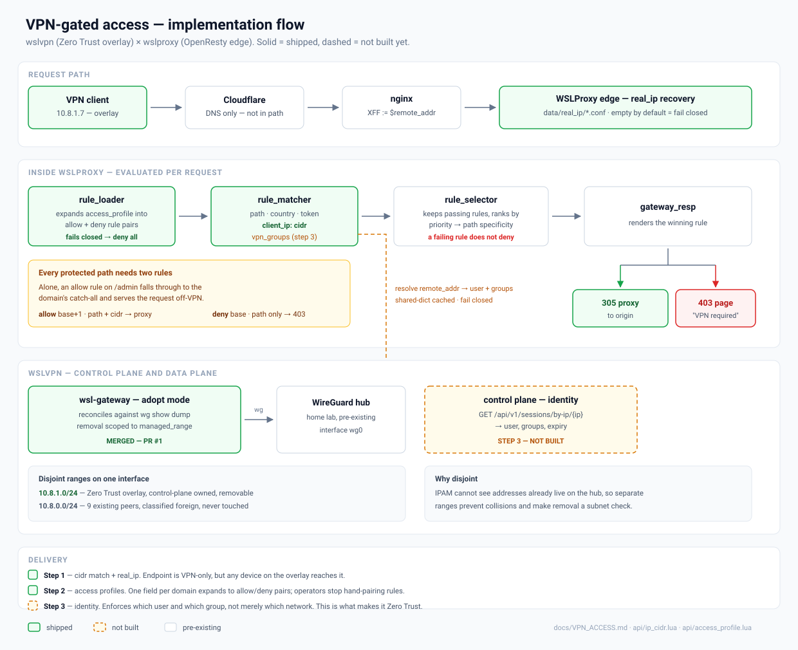

# Lock pre-prod hosts to your VPN with one field

**WSLProxy how-to** · [Live article on wslproxy.org](https://wslproxy.org/blog/vpn-only-hosts.html) · Reference: [VPN_ACCESS.md](../VPN_ACCESS.md)



Keep `int.` and `test.` hostnames on public DNS, but answer only to clients that come in through your VPN or office network. Everyone else gets a branded 403 "VPN required" page. You don't need to reload nginx or set up private DNS.

## Why a profile, not hand-written rules

A VPN rule only works in a pair. The selector drops any rule whose IP check fails, so a lone "allow from VPN" rule lets off-VPN traffic fall through to the catch-all, and that traffic gets proxied anyway. An **access profile** expands each endpoint into the correct allow/deny pair when the config loads.

## 1. Get the real client IP right

```bash
curl -sI https://int.example.com/ | grep -i x-origin-ip   # must be your address, not the front proxy's
```

Configure `data/real_ip/` first if anything sits in front of the edge.

## 2. Define the profile

`data/access_profiles/prod/example-preprod.json`, on **every** edge that serves the host:

```json
{
  "name": "example-preprod",
  "allow_cidrs": "203.0.113.10/32, 10.8.1.0/24",
  "origin": "http://10.0.0.20:8080",
  "endpoints": [{ "path": "/", "path_key": "starts_with" }]
}
```

## 3. Attach it to the host

```json
"access_profile": "example-preprod"
```

in `data/servers/prod/host:int.example.com.json`. The rules take effect on the next request. Generated rules start at priority 1000.

> **Install order matters.** Put the profile on the edges before any host references it. If a profile is missing or invalid, the host fails closed and denies everything (`access_profile failed, denying all requests for <host>`). Edge-sync does not copy `access_profiles/`.

## 4. Verify from both sides

```bash
curl -so /dev/null -w '%{http_code}\n' https://int.example.com/          # 403 off-VPN
curl -sI https://int.example.com/ | grep -iE '^x-(wsl-vpn|origin-ip)'    # verdict + reason
```

ACME (`/.well-known/acme-challenge/`) stays reachable without the VPN, so certificates keep renewing.

## The "VPN required" page

The built-in page has light and dark styling, a reload button, and a link to [wslproxy.org](https://wslproxy.org/). Set `deny_message` (base64 HTML) on a profile to replace it.

## Per-user access

Set `WSL_CONTROL_URL` and add `groups` to a profile or endpoint. Group membership is then resolved against the [wslvpn](https://github.com/bwalia/wslvpn) control plane. See [VPN_ACCESS.md § identity](../VPN_ACCESS.md#per-user-access-identity).
